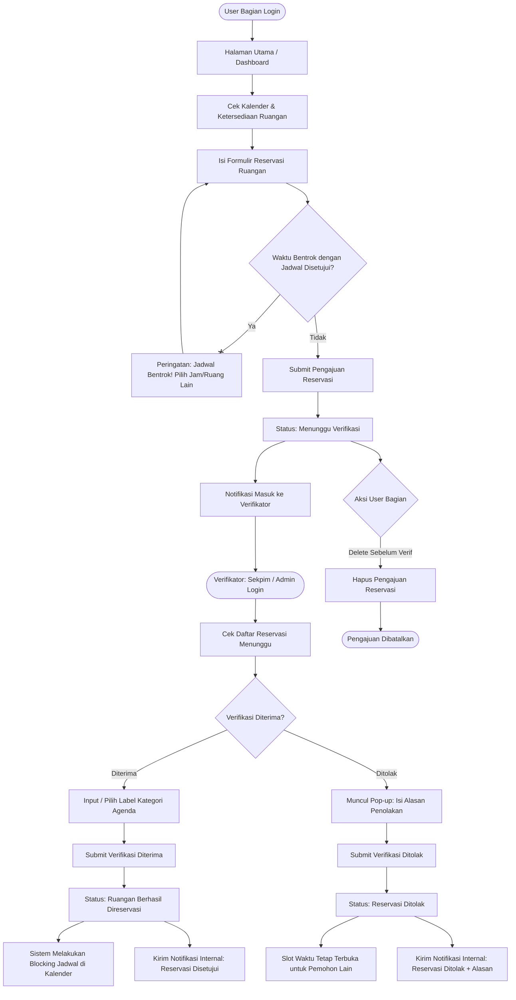
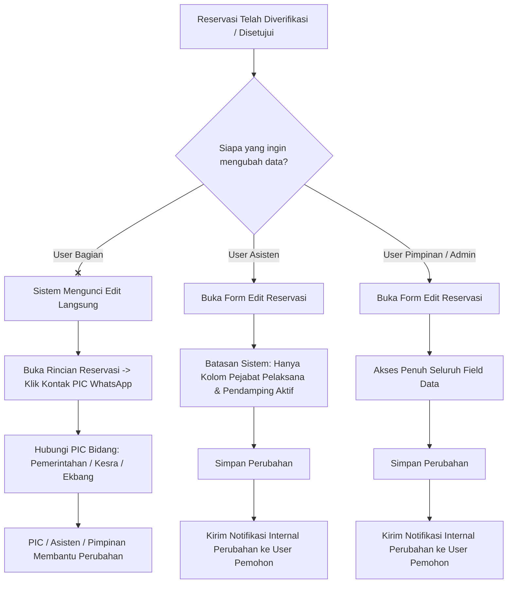
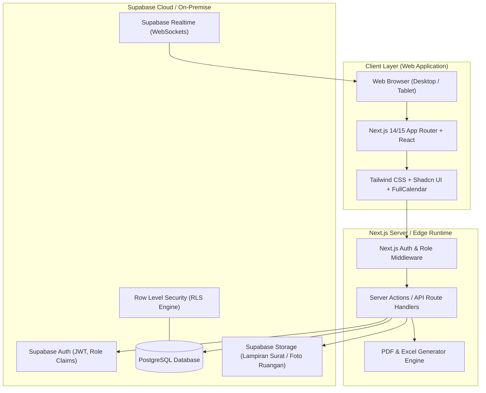
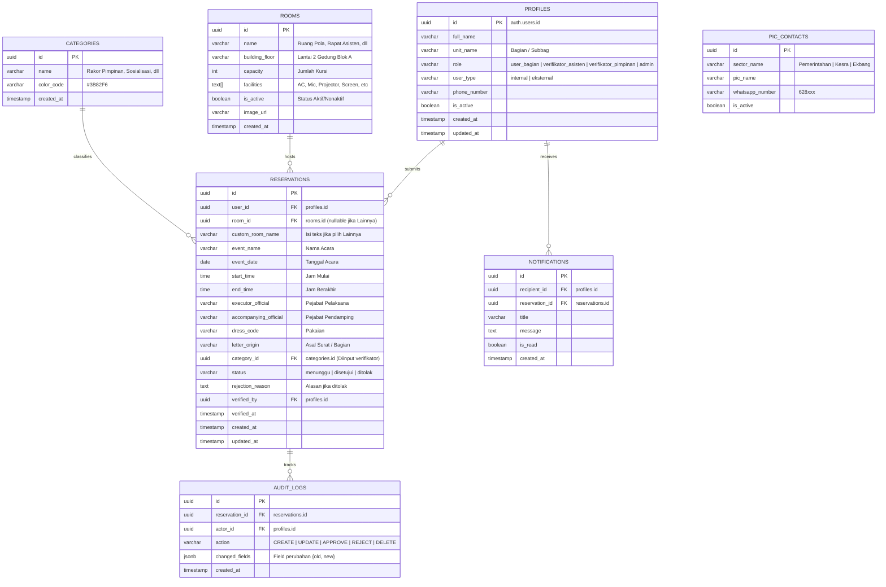

# PRODUCT REQUIREMENT DOCUMENT (PRD)
## Sistem Informasi E-Reservasi Ruang Rapat & Fasilitas Kantor
**Pemerintah Kota Administrasi Jakarta Timur**

---

### Dokumen Kontrol
- **Nama Proyek:** E-Reservasi Ruangan & Fasilitas Kantor Walikota Jakarta Timur
- **Versi Dokumen:** 1.0.0
- **Status Dokumen:** Final Draft (Ready for Development)
- **Target Platform:** Web Application (Desktop & Tablet Responsive)
- **Teknologi Utama:** 
  - **Frontend:** Next.js (App Router, TypeScript, Tailwind CSS, Shadcn UI)
  - **Backend & Database:** Supabase (PostgreSQL, Supabase Auth, Row Level Security / RLS, Realtime)
- **Stakeholder:** Bagian Umum dan Protokol, Suku Dinas Kominfotik, Sekretariat Pimpinan (Sekpim), Seluruh Bagian/Unit Kerja Kantor Walikota Jakarta Timur

---

## 1. Pendahuluan & Latar Belakang

### 1.1 Latar Belakang
Penggunaan ruang rapat dan fasilitas pendukung di lingkungan Kantor Walikota Kota Administrasi Jakarta Timur memiliki intensitas yang sangat tinggi dan melibatkan berbagai Bagian, Suku Dinas, serta Unit Kerja Perangkat Daerah (UKPD). Selama ini, tata kelola peminjaman ruang masih menghadapi berbagai kendala:
1. **Penjadwalan Parsial & Manual:** Koordinasi antar-bagian seringkali dilakukan secara lisan, pesan instan, atau surat fisik yang lambat terekam.
2. **Potensi Benturan Jadwal (Double Booking):** Belum ada sistem terpusat yang secara otomatis memvalidasi irisan waktu (overlap) ketersediaan ruangan.
3. **Ketidakefisienan Pemanfaatan Ruang:** Ruangan berkapasitas besar kerap digunakan untuk agenda kecil, sementara agenda penting kekurangan fasilitas.
4. **Visibilitas Jadwal Pimpinan Terbatas:** Sinkronisasi antara ketersediaan ruangan dengan agenda kehadiran Asisten dan Pimpinan Walikota kerap terlambat diperbarui.
5. **Kesulitan Audit & Pelaporan:** Rekapitulasi histori penggunaan fasilitas untuk kebutuhan pemeliharaan dan evaluasi kinerja sulit disusun dengan cepat dan akurat.

Oleh karena itu, diperlukan sebuah sistem aplikasi berbasis web modern: **E-Reservasi Ruang Rapat & Fasilitas Kantor Walikota Administrasi Jakarta Timur**, yang terintegrasi, transparan, dan mampu mengotomatisasi validasi ketersediaan jadwal secara real-time.

### 1.2 Tujuan Sistem
1. **Pemusatan Data (Centralized Booking):** Menyediakan satu platform terpadu untuk pengajuan, validasi, dan monitoring reservasi ruangan.
2. **Pencegahan Konflik Jadwal (Zero Conflict):** Mencegah double booking melalui mekanisme validasi blocking waktu otomatis.
3. **Optimasi Fasilitas:** Memaksimalkan utilitas ruangan sesuai kapasitas dan kelengkapan fasilitas rapat.
4. **Alur Verifikasi Terstruktur (Governance & Approval):** Memfasilitasi alur verifikasi berjenjang oleh Sekretariat Pimpinan (Asisten & Pimpinan) dan Admin Kominfotik.
5. **Pelaporan & Monitoring Transparan:** Memberikan visualisasi jadwal bergaya kalender interaktif dan kemudahan ekspor rekapitulasi data (PDF/Excel).

### 1.3 Key Performance Indicators (KPI)
- Waktu persetujuan reservasi berkurang dari hitungan hari menjadi < 2 jam pada jam kerja.
- Angka benturan jadwal (jadwal ganda) menjadi 0%.
- Efisiensi pencarian informasi jadwal pimpinan dan ketersediaan ruangan mencapai < 5 detik.
- 100% histori penggunaan ruang terdokumentasi rapi beserta log perubahan data.

---

## 2. Pengguna Sistem & Hak Akses (User Persona & RBAC)

Sistem membedakan hak akses pengguna secara ketat melalui implementasi Role-Based Access Control (RBAC) pada Next.js middleware dan Postgres Row Level Security (RLS) di Supabase.

### 2.1 Matriks Peran Pengguna (Role-Based Access Control)

| Fitur / Hak Akses | User Bagian (Normal User) | Verifikator (Asisten) | Verifikator (Pimpinan) | Admin (Kominfotik) |
| :--- | :---: | :---: | :---: | :---: |
| **Lihat Dashboard & Kalender Jadwal** | Read-Only | Read-Only | Read-Only | Read-Only |
| **Cek Ketersediaan Ruangan** | Read-Only | Read-Only | Read-Only | Full Access |
| **Input Pengajuan Reservasi Baru** | Create | Create | Create | Create |
| **Edit Pengajuan Sendiri (Status: Menunggu)** | Update | Update | Update | Update |
| **Hapus Pengajuan Sendiri (Status: Menunggu)** | Delete | Delete | Delete | Delete |
| **Edit Reservasi Setelah Disetujui** | ❌ (Harus via PIC) | Hanya Pejabat Pelaksana & Pendamping | Semua Field | Full Access |
| **Verifikasi Reservasi (Setujui / Tolak)** | ❌ | Approve / Reject | Approve / Reject | Approve / Reject |
| **Input Label Kategori Agenda** | ❌ | Create / Assign | Create / Assign | Create / Assign |
| **Input Alasan Penolakan** | ❌ | Input Alasan | Input Alasan | Input Alasan |
| **Manajemen Ruangan (CRUD)** | ❌ | ❌ | ❌ | Full Access |
| **Manajemen Pengguna & Role (CRUD)** | ❌ | ❌ | ❌ | Full Access |
| **Laporan & Ekspor Data (PDF / Excel)** | Rekap Pribadi/Bagian | Rekap Bagian/Semua | Rekap Eksekutif | Rekap Seluruh Sistem |
| **Akses Audit Trail / Log Perubahan** | ❌ | ❌ | Read-Only | Full Access |

### 2.2 Rincian Karakteristik Persona

1. **User Bagian (Normal User):**
   - Pegawai/staf perwakilan dari Bagian di lingkungan Kantor Walikota (misal: Bagian Pemerintahan, Bagian Hukum, Kesra, dll.) atau pihak eksternal resmi.
   - Bertugas mengajukan reservasi ruangan untuk agenda rapat unit kerjanya.
   - Dapat membatalkan/menghapus pengajuan **hanya jika status masih 'Menunggu Verifikasi'**.
   - Jika reservasi **sudah diverifikasi**, pengguna tidak dapat mengedit langsung di sistem, melainkan harus menghubungi PIC (Person in Charge) melalui tautan WhatsApp yang disediakan pada rincian agenda.

2. **Verifikator Sekpim - Asisten:**
   - Pejabat atau staf Asisten (Asisten Pemerintahan, Asisten Perekonomian & Pembangunan, Asisten Administrasi & Kesejahteraan Rakyat).
   - Memeriksa agenda reservasi, memvalidasi urgensi rapat pimpinan.
   - Dapat menyetujui (dengan memilih/input Label Kategori) atau menolak (dengan pop-up alasan penolakan).
   - Batasan khusus edit: **Hanya memiliki izin untuk menyunting kolom "Pejabat Pelaksana" dan "Pejabat Pendamping"**.

3. **Verifikator Sekpim - Pimpinan:**
   - Walikota, Wakil Walikota, Sekretaris Kota, atau staf ajudan/Sekpim pimpinan tinggi.
   - Memiliki wewenang penuh dalam disposisi dan verifikasi jadwal pimpinan.
   - Fleksibilitas edit: **Dapat menyunting seluruh data reservasi** kapan saja.
   - Sistem secara otomatis mengirimkan notifikasi internal kepada pemohon jika ada data agenda yang diubah oleh Pimpinan.

4. **Admin (Kominfotik):**
   - Tim teknis Suku Dinas Komunikasi, Informatika, dan Statistik (Kominfotik).
   - Bertanggung jawab atas ketersediaan sistem, manajemen akun pengguna (tambah, edit nama/role/email/tipe internal-eksternal, hapus, reset password).
   - Mengelola master data ruangan (tambah ruangan baru, kapasitas, fasilitas, status aktif/nonaktif).
   - Mengawasi log sistem dan mengintervensi jika terjadi anomali penjadwalan.

---

## 3. Alur Kerja Sistem (System Workflows & Flowchart)

### 3.1 Diagram Alur Pengajuan dan Verifikasi Reservasi


### 3.2 Diagram Alur Perubahan Jadwal Pasca-Verifikasi (Post-Approval Edit)


---

## 4. Spesifikasi Kebutuhan Fungsional (Functional Requirements)

### 4.1 Modul 1: Autentikasi & Manajemen Pengguna
- **FR-AUTH-01 (Login Multi-Role):** Autentikasi menggunakan Supabase Auth (Email & Password) dengan validasi role pada token JWT / metadata profil.
- **FR-AUTH-02 (Keamanan Sesi & Reset Password):** Proteksi brute force, validasi format email kedinasan/pemerintah, serta fitur pengiriman email pemulihan kata sandi (Reset Password).
- **FR-AUTH-03 (Manajemen Pengguna oleh Admin Kominfotik):**
  - **Tambah User Baru:** Form input mencakup Nama Lengkap, Nama Unit Kerja (pilihan dropdown asal unit/bagian), Role (`user_bagian`, `verifikator_asisten`, `verifikator_pimpinan`, `admin`), Email Pengguna, dan Tipe Pengguna (`Internal` atau `Eksternal`).
  - **Edit Data User:** Admin dapat mengubah Nama Unit, Role, Email, dan Status Aktif/Nonaktif akun.
  - **Hapus / Nonaktifkan User:** Soft delete atau deaktifasi akun pengguna.
  - **List User & Filter:** Tabel daftar pengguna dengan fitur pencarian nama/email dan filter role / tipe.

### 4.2 Modul 2: Dashboard Ringkasan & Operasional
- **FR-DASH-01 (Statistik Cepat):** Kartu metrik total reservasi bulan ini, reservasi aktif hari ini, jumlah pengajuan menunggu verifikasi, dan total ruangan operasional.
- **FR-DASH-02 (Widget Jadwal Hari Ini):** Menampilkan daftar rundown kegiatan rapat yang berlangsung hari ini, terurut kronologis jam mulai, dilengkapi nama ruangan, nama acara, dan pejabat pelaksana.
- **FR-DASH-03 (Pusat Notifikasi Cepat):** Menampilkan 5 aktivitas/notifikasi terkini terkait perubahan status reservasi pemohon.
- **FR-DASH-04 (Quick Action):** Tombol pintas "Buat Reservasi Baru" bagi User Bagian dan "Daftar Verifikasi Tertunda" bagi Verifikator.

### 4.3 Modul 3: Manajemen Ruangan & Fasilitas
- **FR-ROOM-01 (Katalog Ruangan):** Menyajikan kartu/daftar ruangan beserta foto ruangan, lokasi lantai/gedung, kapasitas maksimal orang, dan daftar fasilitas (AC, Mic, Sound System, Proyektor, TV LED, Video Conference, Meja Bundar, dsb.).
- **FR-ROOM-02 (Status Operasional Ruangan):** Admin Kominfotik dapat mengubah status ruangan menjadi `Aktif` (dapat dipinjam) atau `Non-Aktif / Maintenance` (otomatis tidak muncul di form reservasi baru).
- **FR-ROOM-03 (CRUD Master Ruangan):** Admin dapat menambah, menyunting detail ruangan/fasilitas, dan menghapus ruangan.

### 4.4 Modul 4: Formulir Reservasi Ruangan & Validasi Konflik
- **FR-RES-01 (Struktur Data Formulir Reservasi):**
  1. **Hari & Tanggal:** Date picker interaktif (hanya tanggal hari ini ke depan, disabled tanggal masa lalu).
  2. **Nama Acara / Kegiatan:** Input teks deskripsi nama rapat/kegiatan.
  3. **Jam Mulai & Jam Berakhir:** Time picker dengan interval 30 menit (jam berakhir wajib lebih besar dari jam mulai).
  4. **Pilihan Tempat (Ruangan):**
     - Dropdown daftar ruangan yang berstatus `Aktif` (misal: Ruang Pola, Ruang Rapat Wakil Walikota, Ruang Rapat Asisten, Ruang Rapat Sekko, dsb.).
     - Opsi **"Lainnya"**: Apabila dipilih, memunculkan input teks bebas (*free text*) untuk nama tempat/ruangan khusus di luar daftar.
  5. **Pejabat Pelaksana:** Pejabat penanggung jawab/pimpinan rapat (misal: Walikota, Wakil Walikota, Sekko, Asisten Ekbang, dll.).
  6. **Pejabat Pendamping:** Pejabat yang mendampingi dalam kegiatan rapat.
  7. **Pakaian (Dress Code):** Input teks atau pilihan cepat (misal: PDH, Batik, PSL, Pakaian Adat, Casual Rapih).
  8. **Asal Surat / Undangan:** Pilihan dropdown unit kerja resmi:
     - *Bagian Pemerintahan*
     - *Bagian Hukum*
     - *Bagian Kepegawaian, Ketatalaksanaan, dan Pelayanan Publik (KKPP)*
     - *Bagian Perekonomian*
     - *Bagian Pembangunan dan Lingkungan Hidup (PLH)*
     - *Bagian Umum dan Protokol*
     - *Bagian Kesejahteraan Rakyat (Kesra)*
     - *Bagian Program, Pelaporan, dan Keuangan (PPK)*
     - *Pemberdayaan Kesejahteraan Keluarga (PKK)*
     - *Lainnya / Unit Eksternal*
- **FR-RES-02 (Validasi Anti-Benturan Otomatis / Conflict Detection):**
  - Sistem melakukan query pengecekan secara real-time pada database Supabase.
  - Formula overlap:
    $$\text{Conflict} \iff (\text{ruangan\_id} = \text{target\_room}) \land (\text{status} = \text{'disetujui'}) \land (\text{tanggal} = \text{target\_date}) \land (\text{jam\_mulai} < \text{target\_selesai}) \land (\text{jam\_selesai} > \text{target\_mulai})$$
  - Jika terjadi irisan dengan jadwal yang **sudah diverifikasi (disetujui)**, sistem memunculkan dialog peringatan merah dan menonaktifkan tombol submit.

### 4.5 Modul 5: Kalender Jadwal Interaktif (Google Calendar Style)
- **FR-CAL-01 (Tampilan Multi-View):** Kalender mendukung tampilan Bulanan (Month View), Mingguan (Week View), Harian (Day View), dan Agenda List.
- **FR-CAL-02 (Indikator Status Tanggal):**
  - **Transparan / Putih / Normal:** Belum ada jadwal terisi pada tanggal tersebut.
  - **Kuning:** Ada jadwal terisi, namun masih tersedia slot waktu kosong pada ruangan.
  - **Merah:** Jadwal pada seluruh ruangan atau ruangan terpilih telah penuh sepanjang jam kerja.
- **FR-CAL-03 (Time-Grid Blocking Area bergaya Google Calendar):**
  - Pada tampilan mingguan/harian, baris jam (07.00 - 18.00) memvisualisasikan kotak blok (*event box*) untuk jadwal yang **sudah disetujui**.
  - Kotak blok menampilkan preview singkat: Nama Acara, Penyelenggara/Bagian, Jam Kegiatan, dan Label Kategori.
  - Warna blok berbeda berdasarkan kategori acara atau status ruangan.
- **FR-CAL-04 (Detail Modal & Kontak WhatsApp PIC):**
  - Mengklik blok kegiatan akan membuka pop-up rincian acara lengkap (Pejabat Pelaksana, Pendamping, Pakaian, Asal Surat).
  - Terdapat tombol tautan langsung ke WhatsApp PIC bidang bersangkutan jika pengguna butuh berkoordinasi:
    - *PIC Bidang Pemerintahan: wa.me/628xxxxxxxxxx (TBA)*
    - *PIC Bidang Kesra: wa.me/628xxxxxxxxxx (TBA)*
    - *PIC Bidang Ekbang: wa.me/628xxxxxxxxxx (TBA)*

### 4.6 Modul 6: Alur Persetujuan (Approval) & Verifikasi
- **FR-APP-01 (Daftar Pengajuan Masuk):** Verifikator (Asisten, Pimpinan, Admin) memiliki halaman khusus yang menampilkan seluruh reservasi dengan status `Menunggu Verifikasi`.
- **FR-APP-02 (Aksi Persetujuan):**
  - Verifikator menekan tombol "Setujui".
  - Verifikator **wajib memilih atau menginput Label Kategori** (contoh label: *Rapat Koordinasi Pimpinan, Evaluasi Kinerja, Sosialisasi, Audiensi Publik, Protokoler, dsb.*).
  - Sistem mengupdate status menjadi `Disetujui`, melakukan blocking slot jam secara permanen di kalender, dan memicu notifikasi internal ke pemohon.
- **FR-APP-03 (Aksi Penolakan):**
  - Verifikator menekan tombol "Tolak".
  - Sistem memunculkan **Pop-up Input Alasan Penolakan** (wajib diisi, misal: *Agenda bersamaan dengan acara Walikota mendadak, Kapasitas ruang tidak sesuai, Dokumen surat belum lengkap*).
  - Sistem mengupdate status menjadi `Ditolak` beserta catatan alasan penolakan, slot waktu tetap bebas, dan memicu notifikasi internal ke pemohon.
- **FR-APP-04 (Mekanisme Penyuntingan Khusus):**
  - **Role Asisten:** Hanya diizinkan mengubah kolom `pejabat_pelaksana` dan `pejabat_pendamping`. Form input field lainnya dalam kondisi disabled/read-only.
  - **Role Pimpinan & Admin:** Dapat mengubah seluruh kolom form reservasi kapan saja.
  - Setiap perubahan data oleh Asisten atau Pimpinan akan otomatis memicu pengiriman notifikasi sistem ke pengguna pemohon terkait perubahan yang dilakukan.

### 4.7 Modul 7: Sistem Notifikasi Internal (In-App Notifications)
- **FR-NOTIF-01 (Notifikasi Status):**
  - Notifikasi instan di dalam aplikasi saat status berubah: `Menunggu` $\rightarrow$ `Disetujui` atau `Ditolak`.
  - Notifikasi saat data pejabat pelaksana/pendamping diubah oleh Asisten/Pimpinan.
- **FR-NOTIF-02 (Pusat Notifikasi & Badge Counter):** Ikon lonceng di navbar dengan indikator angka merah unread yang dapat diklik untuk melihat riwayat pesan dan menandai telah dibaca.

### 4.8 Modul 8: Histori Penggunaan, Audit Trail & Laporan
- **FR-REP-01 (Histori Reservasi Pengguna):** Halaman riwayat peminjaman bagi User Bagian. Pengguna dapat melihat status, rincian, serta menghapus reservasi yang belum diverifikasi.
- **FR-REP-02 (Log Audit Perubahan Data):** Mencatat setiap aktivitas krusial (siapa yang mengubah, field apa yang diubah, nilai lama, nilai baru, dan timestamp waktu perubahan).
- **FR-REP-03 (Rekapitulasi & Statistik):** Admin dan Pimpinan dapat memfilter rekapitulasi penggunaan ruangan berdasarkan rentang tanggal, nama ruangan, bagian asal surat, dan status.
- **FR-REP-04 (Ekspor Data PDF & Excel):**
  - **Excel (.xlsx):** Format tabel data mentah rapi siap olah untuk rekapitulasi laporan bulanan.
  - **PDF Laporan:** Dokumen siap cetak dengan kop surat resmi Walikota Jakarta Timur, tabel jadwal rapi, dan tanda tangan digital/kolom pengesahan.

---

## 5. Arsitektur Teknis & Database (Next.js & Supabase)

### 5.1 Diagram Arsitektur Aplikasi


### 5.2 Desain Skema Database (PostgreSQL / Supabase)



### 5.3 Kebijakan Keamanan Row Level Security (RLS) di Supabase

1. **Tabel `profiles`:**
   - `SELECT`: Pengguna terautentikasi dapat melihat profilnya sendiri; Admin dan Verifikator dapat melihat seluruh profil.
   - `INSERT/UPDATE/DELETE`: Hanya role `admin` (Kominfotik).
2. **Tabel `rooms`:**
   - `SELECT`: Publik / seluruh user terautentikasi dapat membaca data ruangan berstatus aktif.
   - `INSERT/UPDATE/DELETE`: Hanya role `admin`.
3. **Tabel `reservations`:**
   - `SELECT`: Seluruh pengguna terautentikasi dapat membaca reservasi yang telah `disetujui` (untuk keperluan tampilan kalender transparan). User Bagian hanya dapat melihat data lengkap status `menunggu`/`ditolak` miliknya sendiri. Verifikator dan Admin dapat melihat seluruh data reservasi.
   - `INSERT`: Diizinkan untuk seluruh user terautentikasi (`user_bagian`, `verifikator`, `admin`).
   - `UPDATE`:
     - User Bagian: Hanya boleh update saat `status = 'menunggu'` dan `user_id = auth.uid()`.
     - Verifikator Asisten: Hanya boleh menyetujui/menolak, dan menyunting `executor_official` & `accompanying_official`.
     - Verifikator Pimpinan & Admin: Boleh menyunting seluruh kolom.
   - `DELETE`: Hanya pemilik reservasi (`user_id = auth.uid()`) saat `status = 'menunggu'`, atau `admin`.

---

## 6. Kebutuhan Non-Fungsional (Non-Functional Requirements)

### 6.1 Performa & Kecepatan Akses (Performance)
- **Waktu Muat Halaman (Page Load Time):** First Contentful Paint (FCP) di bawah 1.5 detik pada jaringan internal kantor (Local Area Network / Intranet).
- **Efisiensi Kueri Kalender:** Tampilan kalender bulanan memuat ratusan jadwal dengan kueri berindeks (`event_date`, `status`, `room_id`) dengan waktu respon < 200 ms.
- **Client Caching & Optimistic UI:** Pemanfaatan caching Next.js dan TanStack Query / SWR untuk navigasi antar bulan pada kalender tanpa *full page reload*.

### 6.2 Keamanan & Integritas Data (Security)
- **Enkripsi Komunikasi:** Wajib menggunakan HTTPS (TLS 1.3) pada semua pertukaran data antara browser dan server.
- **Proteksi Injection & Sanitasi Data:** Semua input formulir divalidasi ganda menggunakan pustaka schema validation (Zod) baik di sisi client maupun server.
- **Audit Trail:** Segala bentuk perubahan jadwal krusial setelah verifikasi tersimpan di tabel log yang tidak dapat diubah (immutable append-only).

### 6.3 Responsivitas & Kompatibilitas UI/UX
- **Desain Adaptif:** Antarmuka responsif penuh pada resolusi Desktop (1920x1080, 1366x768) serta perangkat Tablet (iPad / Android Tablet ukuran 10-12 inci) yang sering digunakan oleh Asisten dan Pimpinan saat rapat dinas luar.
- **Aksesibilitas & Keterbacaan:** Mengikuti panduan warna Pemprov DKI Jakarta (aksen biru navy, emas/oranye ramah mata, serta kontras warna WCAG AA).

---

## 7. Struktur Halaman & Navigasi (Sitemap)

```
├── / (Landing Page / Redirect ke Login)
├── /login (Halaman Masuk & Form Pemulihan Sandi)
├── /dashboard (Ringkasan Penggunaan, Jadwal Hari Ini, Notifikasi Cepat)
├── /kalender (Kalender Jadwal Interaktif Month/Week/Day + Blocking Area Google Calendar)
├── /reservasi
│   ├── /reservasi/baru (Formulir Pengajuan Reservasi Ruangan + Validasi Realtime)
│   ├── /reservasi/riwayat (Daftar Riwayat Reservasi Pengguna Sendiri & Tombol Batal)
│   └── /reservasi/[id] (Detail Rincian Reservasi + Kontak WhatsApp PIC Bidang)
├── /verifikasi (Khusus Asisten, Pimpinan, dan Admin)
│   ├── /verifikasi/menunggu (Tabel Antrean Persetujuan + Modal Terima/Tolak)
│   └── /verifikasi/jadwal-pimpinan (Jadwal Khusus Pejabat Walikota & Sekko)
├── /ruangan (Katalog & Status Ruangan, CRUD Ruangan untuk Admin)
│   └── /ruangan/[id] (Detail Fasilitas & Histori Pemakaian Ruangan)
├── /laporan (Rekapitulasi Penggunaan, Grafik Statistik, Export PDF/Excel)
├── /pengaturan
│   ├── /pengaturan/profil (Profil Akun & Ubah Password)
│   ├── /pengaturan/users (Khusus Admin: Tambah, Edit, Hapus, Kelola Role User)
│   └── /pengaturan/pic-kontak (Kelola Kontak PIC WhatsApp Pemerintahan, Kesra, Ekbang)
```

---

## 8. Rencana Implementasi & Roadmap Pengembangan

| Fase | Durasi | Milestone & Cakupan Pekerjaan |
| :--- | :---: | :--- |
| **Fase 1: Inisiasi & Backend Setup** | Minggu 1 | - Setup project Next.js (App Router, Tailwind CSS, TypeScript, Shadcn UI)<br>- Konfigurasi Supabase Project (PostgreSQL, Tables DDL, RLS Policies, Auth)<br>- Seeding master data ruangan, unit bagian, dan PIC bidang |
| **Fase 2: Autentikasi & Core Reservation** | Minggu 2 | - Implementasi Login, Proteksi Route, Session Management<br>- Pembuatan Form Reservasi Ruangan dengan validasi Zod & overlap query Supabase<br>- Halaman Riwayat Reservasi dan aksi batalkan sebelum verifikasi |
| **Fase 3: Kalender Interaktif & Blocking Jadwal** | Minggu 3 | - Integrasi komponen Kalender (Google Calendar-style time grid)<br>- Implementasi indikator warna tanggal (Putih/Transparan, Kuning, Merah)<br>- Blok jadwal terverifikasi, preview rincian kegiatan, dan tombol kontak WhatsApp PIC |
| **Fase 4: Modul Approval & Edit Khusus Role** | Minggu 4 | - Halaman antrean verifikasi untuk Asisten, Pimpinan, dan Admin<br>- Modal persetujuan (Label Kategori) & Modal penolakan (Alasan Penolakan)<br>- Logika restriksi edit: Asisten (hanya pejabat pelaksana & pendamping), Pimpinan (semua field)<br>- Integrasi notifikasi internal in-app |
| **Fase 5: Manajemen Admin & Ekspor Laporan** | Minggu 5 | - Modul Kelola Pengguna (Admin Kominfotik) dan Kelola Ruangan<br>- Fitur Ekspor Rekapitulasi ke file Excel (.xlsx) dan Dokumen Resmi PDF<br>- Audit Trail log viewer untuk mencatat histori perubahan data |
| **Fase 6: UAT, Testing & Deployment** | Minggu 6 | - User Acceptance Testing (UAT) bersama Kominfotik, Sekpim, dan Bagian Umum<br>- Uji beban (performance test) & hardening security RLS<br>- Deployment ke server/infrastruktur resmi Pemkot Jakarta Timur & Pelatihan User Guide |

---

## 9. Pertimbangan Tambahan & Catatan Kebijakan Khusus
1. **Kebijakan Perubahan Jadwal Pasca-Verifikasi:**
   Untuk menjaga integritas dan ketertiban protokoler, pemohon tidak diberikan akses edit langsung begitu status reservasi menjadi `Disetujui`. Segala bentuk perubahan jadwal harus dikoordinasikan langsung ke PIC Bagian (Pemerintahan, Kesra, Ekbang) melalui kanal WhatsApp yang tertera di sistem.
2. **Kerahasiaan Jadwal Tertentu:**
   Untuk agenda pimpinan yang bersifat internal/rahasia, Verifikator Pimpinan dapat menandai kategori sebagai *Internal Pimpinan*, di mana rincian agenda hanya menampilkan label "Agenda Pimpinan" pada kalender umum.
3. **Data Kontak PIC yang Perlu Dilengkapi (TBA):**
   - Nomor WhatsApp PIC Bagian Pemerintahan
   - Nomor WhatsApp PIC Bagian Kesejahteraan Rakyat (Kesra)
   - Nomor WhatsApp PIC Bagian Perekonomian dan Pembangunan (Ekbang)

